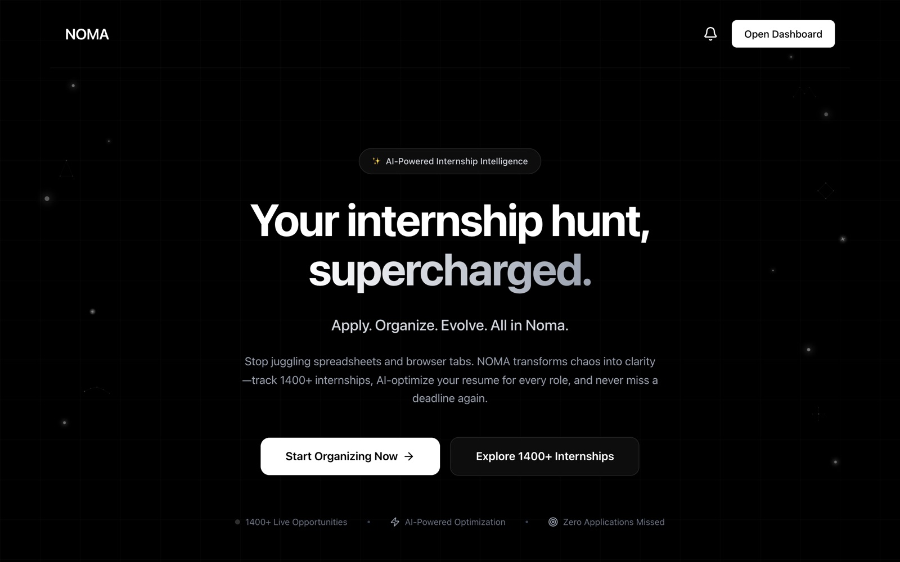
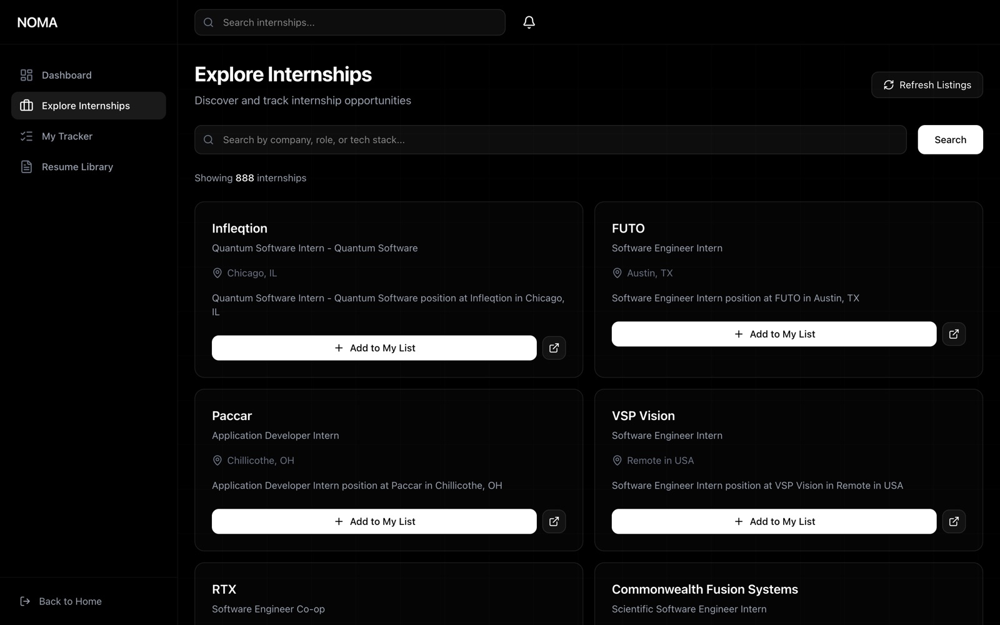

# NOMA

**The internship hunt in one place.** NOMA pulls every live internship posting
from GitHub, tracks where each application stands, and uses Gemini to score
your resume against a job description, list what's missing, and export a
tailored version as a PDF.

**[noma-amber.vercel.app](https://noma-amber.vercel.app)** · Built at HackTX 2025



## What it does

- **Discover.** Postings sync from the community-maintained
  [SimplifyJobs internship list](https://github.com/SimplifyJobs/Summer2027-Internships),
  one of the most-starred on GitHub. Search by company, role or tech stack and add
  any posting to your tracker in one click.
- **Track.** Every application moves through Apply later, Applied, Interview,
  Offer and Rejected, with reminders and a deadline countdown. Deadlines in the next
  7 days and reminders in the next 3 show up in the notification bell.
- **Tailor.** Upload a PDF or DOCX resume, pick a tracked role, and Gemini
  returns a match score, the skills you already show, the ones the posting asks
  for that you don't, and rewritten summary, experience and skills sections.
  Download the tailored version as a formatted PDF.
- **See the whole hunt.** The dashboard charts applications by status and week,
  your average match score and what's due next.



## How it works

**Private without accounts.** Each browser gets a random id the first time it
opens NOMA and sends it with every request. The backend keeps that visitor's
resumes, tracker and analyses in their own folder, and resume files are only
served back to the browser that uploaded them, so the public demo never mixes
anyone's data. The internship list is shared.

**Resilient AI calls.** Gemini models get overloaded and retired. Every call
goes through one function that retries a busy model once, falls back to the
next model in the chain (`gemini-flash-latest`, then `gemini-3.8-flash`, then
`gemini-flash-lite-latest`), gives each attempt 30 seconds, and skips models
that have been retired. A busy model makes an analysis slower, never broken.

**Resume pipeline.** `pdf-parse` and `mammoth` extract the text, Gemini
returns structured JSON, and Puppeteer renders the tailored resume from an
HTML template to PDF. The backend ships as a Docker image with Chromium so PDF
export works in production.

| Layer | Stack |
| --- | --- |
| Frontend | Next.js 15, React 19, Tailwind CSS 4, Framer Motion, Recharts, Zustand (Vercel) |
| Backend | Node.js, Express, Multer, Docker (Railway) |
| AI | Google Gemini via `@google/generative-ai` |
| Documents | pdf-parse, mammoth, Puppeteer |
| Data | JSON files: shared internships, per-browser everything else |

## Run it locally

Requires Node 20+ and a free [Gemini API key](https://aistudio.google.com/apikey).

```sh
cd noma.backend
npm install
echo "GEMINI_API_KEY=your_key" > .env
npm start                      # API on :5001

cd ../noma.frontend
npm install
npm run dev                    # app on :3000
```

The frontend talks to `http://localhost:5001/api` by default; set
`NEXT_PUBLIC_API_URL` to point it elsewhere. Internships load from GitHub on
the first start. See [`noma.backend/API_DOCUMENTATION.md`](noma.backend/API_DOCUMENTATION.md)
for the API.

| Directory | Contents |
| --- | --- |
| `noma.frontend/` | Landing page, dashboard, internships, tracker, resume library |
| `noma.backend/services/` | Gemini analysis, GitHub sync, PDF rendering |
| `noma.backend/utils/` | Per-browser JSON storage, text extraction |
| `noma.backend/templates/` | Resume PDF template |

## License

[MIT](LICENSE)
